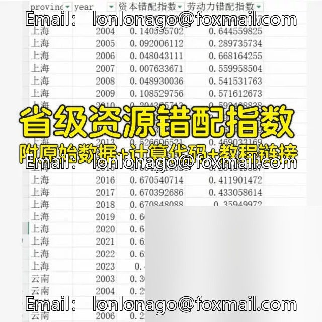

# Provincial-level resource misallocation index / resource allocation efficiency data

## Body

Provincial-level resource misallocation index/resource allocation efficiency data
Scope: 30 provinces of data
Time: 2003-2023

Data includes original data, calculation results, re-computation codes, and references, all organized by oneself, to save time and effort, can be used directly, and the results have passed the significance test, so you can use with confidence!

Data sources: "China City Statistics Yearbook", EPS database, research paradigm referencing the method of Bai Junhong (2018) in "China Industrial Economy", results are standardized and directly usable core variables!

web-based shipment, can be directly photographed and shipped.

The dataset covers resource mismatch indices and allocation efficiency data for 30 provincial regions, spanning from 2003 to 2023, including raw data, computed results, reproduction code and references.

<!-- AI_ENRICHED -->

## Images

## Payment

Here is a pay link on Stripe ( https://buy.stripe.com/3cs8yP7sY87d0vu9AB ). Please contact me lonlonago@foxmail.com after funding $89, and I will send you a complete data files , thank you!

